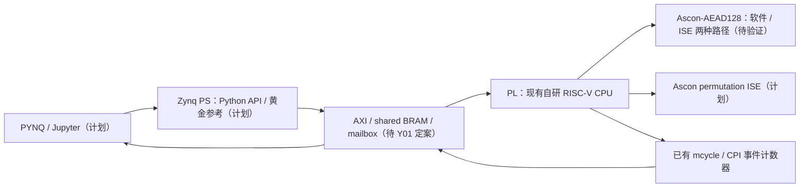

# RISC-V Lightweight Cryptography SoC with ASCON ISE

在 CICC1000023「基于 RISC-V 的高性能 CPU 设计及 FPGA 验证」基础上扩展轻量级密码学：在自研 RISC-V CPU 上运行 **NIST SP 800-232 Ascon-AEAD128**，加入 custom instruction set extension（ISE），通过 FPGA 实测比较软件与 ISE，再用 PYNQ/Jupyter 完成控制、黄金参考比对和展示。

| 项目 | 约定 |
|---|---|
| 比赛 | 全国大学生嵌入式芯片与系统设计竞赛 2026，FPGA 创新设计赛道，AMD 自主选题初级组 |
| 目标硬件 | Zynq-7000 **XC7Z020CLG400-1**；具体板卡型号、版本、PYNQ image 待 B03 核实 |
| 最终提交 | **2026-11-04**（用户给定截止日期；11 月 4 日不安排开发） |
| 当前阶段 | 真实 CICC1000023 baseline 源恢复已本地提交；Vivado/上板复现待验证 |
| 当前工程实际配置 | 恢复 baseline：`xc7z020clg400-1` / Vivado `2025.2` / `top_pl_bram`；原 Kintex 工程另行保留 |
| 开源协议 | [Apache-2.0](LICENSE)；引入第三方代码须单独核对来源与许可 |

比赛规则以可追溯官方原文为准。仓库中的历史选题指南只作已有资料，不把未核实条款、评分或工具限制写成官方结论。

## 基线 CPU

继承自研五级流水线，RV32/RV64 参数化，RV32IM/RV64IM、Zicsr、M-mode 异常与中断、旁路与流水线控制、动态分支预测、I/D Cache、总线互连、CPU AXI Bridge/AXI Master、UART/GPIO/CLINT 与计数器。当前 `src/rtl/defines.v` 默认 `XLEN=32`。这些是已有源码/项目背景描述，不等同于本仓库已通过全套验证。

周期数来自 `csr_file.v` 的 `mcycle`；`cpi_cnt.v` 提供退休与停顿等事件统计。详见 [接口与测量约定](docs/interfaces.md)。

## 系统架构

现有工程实际是 `top_pl_bram → top → soc_top → cpu_core/总线/外设`，所需三个 IP XCI 已从原始 ZIP 恢复到独立 baseline 工作区；上图中的 PS/PYNQ 链路尚未实现。详见 [架构](docs/architecture.md)。

## 仓库结构

| 路径 | 用途 / 现状 |
|---|---|
| `src/rtl/` | 保持原位的 CPU、Cache、总线、外设；`ascon/` 只有初步辅助模块 |
| `ascon/ascon_c/`、`ascon/pyascon/` | 已有 C/Python Ascon；版本来源与最终标准 KAT 待确认，不搬入 `src/` |
| `board/vivado_zynq7000_xc7z020_baseline/` | 原比赛 XPR、31 RTL/header、3 XCI、XDC、FreeRTOS COE |
| `board/vivado_kintex7_legacy/` | 原 tracked 工程经 git mv 归并后的唯一 Kintex 入口；只作 legacy |
| `src/firmware/cicc1000023/` | CoreMark RV32/RV64、FreeRTOS 应用、RISC-V tests 源/构建输入 |
| `sim/cicc1000023/` | 恢复的模块/ISA/formal 验证源；适配与完整回归待完成 |
| `build/` | 资产哈希/原名还原脚本、精选历史报告、本轮验证元数据 |
| `data/` | recovery 清单/哈希/差异/小测试输入；可信 Ascon KAT/benchmark 仍待建立 |
| `skill/` | 不绑定 Ascon 的通用 PYNQ Skill 预留 |
| `report/` | 报告、图表、视频索引与 LLM 协作记录预留 |
| `docs/` | 审计、技术契约、架构与工作流程 |
| `tasks/` | 任务、依赖、验收与内部里程碑 |
| `project_log/` | 已发生的进度、开发活动、失败与经验 |

完整原始树、逐文件清单与差异见 [仓库审计](docs/repository_audit.md)。新增普通路径用英文小写、数字、下划线或连字符；扩展名分隔点及明确要求的 `README.md`、`AGENTS.md`、`.gitignore` 是约定例外。已有路径不做批量改名。

## 当前进度（2026-09-21）

- B01 / D00：审计与协作骨架完成；全部任务 owner 仍为 `TBD`。foundation 收口已去重 Kintex 并清理两项旧生成元数据，详见 [收口检查](docs/repository_foundation_closeout.md)。
- 原始 ZIP 已找到真实 XC7Z020 工程、三个 IP、固件/测试和历史 bitstream/report；选取 579 个资产恢复，已纳入本地提交。Git HEAD 缺失不等于资料不可用。
- Icarus 12.0：恢复 RTL 的 `top` elaboration、`tb_bypass`、`tb_regfile` 通过；未重跑 Vivado/IP/固件构建或上板。历史 100 MHz / WNS 0.056 ns 仅作归档证据。
- 已有 Ascon C/Python 和 `ror/load_bytes/store_bytes` RTL，尚无可信 KAT 比对结果、指令接入、benchmark 或 PPA 数据。
- B02/B03 与 C01 是下一步入口；PYNQ 未开始，PUF/启动认证处于门禁状态。

事实台账以 [actual_progress](project_log/actual_progress.md) 为准，任务字段以 [task_board](tasks/task_board.md) 为准。

## 从零复现入口

1. `git clone https://github.com/HChenZ/amd_fpga_2026.git`，进入目录后记录 `git rev-parse HEAD` 和 `git status --short`。
2. 按 [AGENTS.md](AGENTS.md) 阅读项目约定，再读 [审计](docs/repository_audit.md) 的缺口清单。
3. 按 [build/readme.md](build/readme.md) 做已有 RTL 的静态 elaboration 检查；这不是 CPU 程序验证。
4. 阅读 [恢复审计](docs/cicc1000023_recovery_audit.md)，运行 `python build/prepare_cicc1000023_sources.py` 核对恢复资产。B02 用 Vivado 2025.2 复现独立的真实 XC7Z020 baseline；B03 核对实物板；B04 补齐准确的 FreeRTOS kernel/bootloader 来源和测试适配。操作要求见 [开发流程](docs/development_workflow.md)。
5. baseline 验收后，按 C01→C02→C03→C04 接通标准软件与板上 cycle；然后进入 Ixx 与 Yxx。

**目前不能承诺 clean clone 即可上板运行。** 恢复内容已本地提交，本轮尚未 push；历史 bitstream 保留在 ZIP，不是本轮重建/上板结果。PS/PYNQ overlay 尚未实现。

## 文档索引

| 文档 | 内容 |
|---|---|
| [AGENTS.md](AGENTS.md) | 三分钟入场、行为红线 |
| [project_overview](docs/project_overview.md) | P0/P1/P2 与完成定义 |
| [repository_audit](docs/repository_audit.md) | 初始 HEAD 审计快照及恢复后的结论更正 |
| [recovery_audit](docs/cicc1000023_recovery_audit.md) / [rtl_diff](docs/cicc1000023_rtl_diff.md) / [vivado_diff](docs/vivado_project_diff.md) | ZIP 工程、固件审计、逐文件哈希与源配置比较 |
| [architecture](docs/architecture.md) / [interfaces](docs/interfaces.md) | 当前与目标架构、地址和交接契约 |
| [technical_rules](docs/technical_rules.md) | 标准、ISE、验证和测量规范 |
| [development_workflow](docs/development_workflow.md) / [agent_workflow](docs/agent_workflow.md) | 分支、评审、复现和 agent 交接 |
| [decisions](docs/decisions.md) / [risks](docs/risks.md) | 决策及风险触发条件 |
| [task_board](tasks/task_board.md) / [milestones](tasks/milestones.md) | 任务清单、日期与门禁 |
| [development_log](project_log/development_log.md) / [actual_progress](project_log/actual_progress.md) / [lessons_learned](project_log/lessons_learned.md) | 开发活动、已验事实、失败与经验 |

## 开发规范

保留 baseline 路径；先读接口再修改；RTL 变更附验证，ISE 附 spec/encoding/semantics、RTL/software test、KAT 和 cycle benchmark。第一阶段只用 inline asm/intrinsic，不修改 GCC backend。实测、仿真和估算分开记录，禁止编造性能数据。`main` 的目标是始终可构建/运行；当前复现缺口须先由 B02/B03 关闭，不能靠文字认定已满足。

推荐 `feat/ascon-sw`、`feat/ascon-ise`、`feat/pynq`、`feat/puf`、`feat/boot-auth`、`docs/*`、`fix/*`。**agent 不自行 commit/push**；本轮只交付工作区改动，由用户检查。

## 内部 milestone

| 日期（2026） | 门槛 |
|---|---|
| 09-23 | 骨架与 baseline audit |
| 09-30 | 软件 Ascon-AEAD128 + KAT + RISC-V cycle |
| 10-07 | ISE spec + RTL + unit test |
| 10-14 | CPU 集成、软件/ISE 都运行、第一版真实加速比 |
| 10-21 | PYNQ/Jupyter、自动 KAT 与 benchmark；达标后才可开启 PUF |
| 10-27 / 10-28 | 核心功能冻结 / 内部 code freeze |
| 10-29～11-01 | 报告、图表、PPT、视频、Skill、LLM 记录 |
| 11-02 / 11-03 / 11-04 | 干净环境复现 / 仅材料修复 / 正式提交 |

验收细则见 [milestones](tasks/milestones.md)。**当前不要做：** Ascon ISE + PYNQ 全部稳定前，PUF、PUF-derived key 与 authenticated boot 不进入主线；不未经引用核验移动 Vivado、不删除旧代码、不直接编辑生成文件；本轮用户授权的 Kintex rename 已完成核验。
