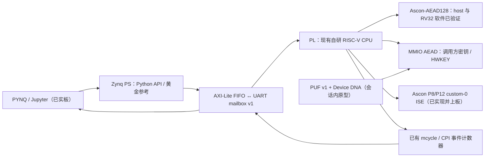

# RISC-V Lightweight Cryptography SoC with ASCON ISE

2026-11-01 当前状态入口：[最终报告 PDF](docs/tech_report/amd_fpga_2026_latex_final/amd_fpga_2026_report/output/pdf/final_report.pdf)、[提交计划](tasks/release_plan_20261101.md)、[提交入口与证据包](submission/README.md)、[PUF3 板测结果](data/pynq_puf3/notebook_20261031_114512/result.json)、[Skill L3 汇总](data/skill/l3_20261031_063709/40_summary.json)。主演示为 PUF3 overlay（SW/MMIO/ISE 三模式 + RO-PUF/DNA 密钥通路同一 bit），10-31 在正点原子领航者 ZYNQ7020 实板三模式各 289/289 KAT，KAT #529 加密 21862/1369/3895 cycles（15.969×/5.613×）；PUF 仅会话内功能证据，RO 计数器域未签核、跨上电未测。PYNQ v1 release 作历史对照。`pynq-overlay-workflow` Skill S01–S05 已完成（L1、L2 `simulated`、L3 实板）。实机演示视频、clean-clone 与最终冻结提交仍待完成。

**先选版本再运行**：[当前/旧入口速查](docs/version_entrypoints.md)、[全部版本清单](docs/version_inventory_20261101.md)。
PUF3 的板测入口是 [PUF3 Notebook 使用说明](src/pynq_puf3/readme.md)；`src/pynq/board_demo.py`、
`board_benchmark.py`、`board_error_gate.py` 及 `src/pynq/` 下两个已执行板测 Notebook 均是 **旧 PYNQ v1**。
本次只厘清说明，不更改它们的默认行为，不把旧门禁和 Skill L3 结果转记到 PUF3。

在 CICC1000023「基于 RISC-V 的高性能 CPU 设计及 FPGA 验证」基础上扩展轻量级密码学：在自研 RISC-V CPU 上运行 **NIST SP 800-232 Ascon-AEAD128**，加入 custom instruction set extension（ISE），通过 FPGA 实测比较软件与 ISE，再用 PYNQ/Jupyter 完成控制、黄金参考比对和展示。

| 项目 | 约定 |
|---|---|
| 比赛 | 全国大学生嵌入式芯片与系统设计竞赛 2026，FPGA 创新设计赛道，AMD 自主选题初级组 |
| 目标硬件 | 正点原子领航者 ZYNQ7020；part **xc7z020clg400-1**；已有底板 V3.9/核心板 2V5 记录，完整芯片丝印/速度等级仍待取证；FCLK0 有 99.9723 MHz 时基估测，非示波器/Fmax 测量 |
| 最终提交 | **2026-11-01 提交并冻结**（10-29 用户授权，取代原 11-04 安排；非官方赛期推断） |
| 当前阶段 | PUF3 容量内板测、报告 PDF、Skill S01–S05 和冻结留档已有证据；视频/PPT、完整 clean-clone 等边界未关闭；V03 9/9 仅属旧 PYNQ v1 |
| 当前工程实际配置 | 主演示 `xc7z020clg400-1` / Vivado `2025.2` / **pynq_puf3_wrapper** / FCLK0 100 MHz / PQF3 / pynq-svc-puf3；旧 `pynq_wrapper`、原 baseline 与 Kintex legacy 独立保留 |
| 开源协议 | [Apache-2.0](LICENSE)；引入第三方代码须单独核对来源与许可 |

比赛规则以可追溯官方原文为准。仓库中的历史选题指南只作已有资料，不把未核实条款、评分或工具限制写成官方结论。

## 2026-10-16 密钥安全与上板前审查（历史记录）

以下“板型未知/无实板”只描述 10-16，当时的安全修复证据仍保留；当前实板状态以上方 11-01 入口为准。

三套软件/MMIO/ISE实现已存在并经本轮审查；修复认证失败输出、MMIO清零与读门禁、
ISE状态生命周期及CPU提前译码/完成握手。结果、剩余风险和复现入口见
[密钥管理审查](docs/ascon_key_management.md)、[最终验证汇总](data/ascon/results/key_lifecycle/final_validation_summary.json)、
[100 MHz时序审查](docs/ascon_timing_review.md)、
[借板清单](docs/ascon_board_checklist.md)。板型仍未知，无实板验证。
下文2026-10-09进度为历史快照，不能覆盖较新的实际进度。

## 基线 CPU

继承自研五级流水线，RV32/RV64 参数化，RV32IM/RV64IM、Zicsr、M-mode 异常与中断、旁路与流水线控制、动态分支预测、I/D Cache、总线互连、CPU AXI Bridge/AXI Master、UART/GPIO/CLINT 与计数器。当前 `src/rtl/defines.v` 默认 `XLEN=32`。这些是已有源码/项目背景描述，不等同于本仓库已通过全套验证。

周期数来自 `csr_file.v` 的 `mcycle`；`cpi_cnt.v` 提供退休与停顿等事件统计。详见 [接口与测量约定](docs/interfaces.md)。

## 系统架构



原始 baseline 仍为 `top_pl_bram → top → soc_top → cpu_core/总线/外设`。当前 PUF3 与旧 PYNQ v1 均使用独立 BD：
PS7 GP0 两个 AXI-Lite 窗口接 `pynq_ctl`/`pynq_mbox`，后者通过 RV32 UART uncached MMIO 连接服务固件。
PUF3 必须选用 `board/vivado_zynq7000_xc7z020_pynq_puf3/rtl/` 的 soc_top/key_mmio 变体，
不能直接换成 `src/rtl/soc_top.v`。详见 [架构](docs/architecture.md) 与
[PUF3 工程说明](board/vivado_zynq7000_xc7z020_pynq_puf3/readme.md)。

## 仓库结构

| 路径 | 用途 / 现状 |
|---|---|
| `src/rtl/` | 公共 CPU/Cache/总线/外设/Ascon ISE 与 AEAD；PUF3 的两个顶层变体在 board 下，由专用 build.tcl 排除/替换，不能任意全量加入 |
| `ascon/ascon_c/`、`ascon/pyascon/` | 标准算法与 host 验证实现；生产 C 被当前 RV32 固件复用；不是另一个 PUF3 overlay |
| `board/vivado_zynq7000_xc7z020_baseline/` | 原比赛 XPR、31 RTL/header、3 XCI、XDC、FreeRTOS COE |
| `board/vivado_kintex7_legacy/` | 原 tracked 工程经 git mv 归并后的唯一 Kintex 入口；只作 legacy |
| `src/firmware/cicc1000023/` | CoreMark RV32/RV64、FreeRTOS 应用、RISC-V tests 源/构建输入 |
| `sim/ascon/` | Final host validation、认证失败门禁、独立round/P8/P12与AEAD加解密、全源集回归、故障注入与golden接口；历史FAIL保留 |
| `sim/cicc1000023/` | 恢复的模块/ISA/formal 验证源；适配与完整 CPU 回归待完成 |
| `build/` | 资产哈希/原名还原脚本、精选历史报告、本轮验证元数据 |
| `data/ascon/` | 锁定来源与许可、完整 Final KAT、固定 golden vectors、host/RTL 与失败证据 |
| `data/pynq/` | PYNQ v1 release（历史对照）：10-28 容量内 KAT、10-31 warm benchmark 与错误恢复门禁原始证据 |
| `data/pynq_puf3/` | PUF3 主演示 10-31 实板结果（KAT、benchmark、PUF）；10-30 旧运行已移出，存于 Git 历史 |
| `data/recovery/` | CICC1000023 recovery 清单、哈希、差异与小测试输入 |
| `skill/` | 通用 PYNQ Skill 与 L1/L2/L3 验证；L3 Ascon 工件为旧 v1，另有 GPIO/DMA 回环 |
| `report/` | 当前视频脚本、讲解材料与 LLM 协作记录；最终 PDF 位于 docs/tech_report 的独立 LaTeX 工程 |
| `docs/` | 审计、技术契约、架构与工作流程 |
| `tasks/` | 任务、依赖、验收与内部里程碑 |
| `project_log/` | 已发生的进度、开发活动、失败与经验 |

完整原始树、逐文件清单与差异见 [仓库审计](docs/repository_audit.md)。新增普通路径用英文小写、数字、下划线或连字符；扩展名分隔点及明确要求的 `README.md`、`AGENTS.md`、`.gitignore` 是约定例外。已有路径不做批量改名。

## 历史进度快照（2026-10-09）

已验证：

- NIST SP 800-232 Final / Ascon-AEAD128 是唯一主线。Final PDF、ascon-c/pyascon 固定提交、CC0 许可、逐文件 SHA-256 和本项目使用的 289 组接口 KAT 已锁定，见 [标准基准](docs/ascon_standard_baseline.md)。
- 仓库 C/Python host 实现与锁定 KAT 逐字节一致；完整四 backend host validation 为 28,661 PASS / 0 FAIL。C decrypt 的项目安全契约已修复并通过 23,965 项 raw-buffer 检查：认证失败返回 `-1`、`mlen=0`，并清除已知长度的候选明文。
- 独立 golden regression 已验证 round、P8、P12；`ascon_aead_2.v` encryption 已用锁定 Final reference 验证长度边界、尾零、reset 和连续请求。队友 testbench 的五组 ciphertext/tag 也由独立 reference 证实。
- RTL加密/独立解密均通过接口内全部289组官方Final KAT及11组补充输入；decrypt通过2,579次篡改拒绝，认证前/失败不发布明文；加解密各735组超长参数明确拒绝。全部生产Ascon源码编译、加解密仿真exit0，10个module无重复，详见[本轮验证](docs/ascon_rtl_decrypt_validation.md)。
- CICC1000023 恢复资产、真实 XC7Z020 XPR/XCI/XDC/COE 和固件输入已纳入仓库；恢复 RTL 的 `top` elaboration、`tb_bypass`、`tb_regfile` 已通过既有 Icarus 检查。

部分完成：

- 当前 `ascon_aead_2.v` encryption 接口最多容纳 plaintext 16 bytes、AD 16 bytes；这是当前接口能力上限，不代表 Final 算法长度上限。
- 当前 128-bit 接口覆盖 PT/AD 各 0..16 bytes 的全部 289 组 KAT；不把超出当前接口的多块算法能力写入板端 KAT 结论。完整算法长度在 host 软件验证；多块硬件、Vivado 综合与 CPU 接口集成仍待完成。
- XC7Z020 baseline 源已恢复，但 Vivado 重新生成 IP、综合、实现、固件加载和实板复现尚未完成。

尚未完成：

- CPU custom ISE 的 spec、decode/execute、流水线集成和 inline assembly/intrinsic 尚未完成；独立AEAD核心通过不能代替CPU ISE门禁。
- 目标 RISC-V/PYNQ 板上已有容量内 KAT 与 `mcycle` 原始样本；最终 warm benchmark、cycles/byte、加速比统计和独立 FCLK 测量仍未完成。
- PYNQ/PS-PL 控制链已在实板完成容量内三模式验证；Notebook 顺序执行、长时间连续请求、完整错误门禁和 clean-clone FPGA 端到端复现尚未完成。

历史证据：归档中有旧工程 bitstream/report，以及 100 MHz 下 WNS 0.056 ns、placed LUT/FF/BRAM/DSP 等历史结果；它们不是当前 Ascon 集成的本轮重建、PPA 或上板实测。

计划项（早期规划，保留原文；11-01 状态见顶部）：P0 继续收口 baseline、目标软件、RTL integration/decrypt 和 CPU ISE；PYNQ 属于后续 P1。PUF/启动认证仍受门禁约束并暂缓，不进入当前主线——11-01 起 PUF 密钥通路已以 PUF3 overlay 进入主演示（仅会话内功能证据），启动认证仍未开展。全部 owner 仍为 `TBD`。

事实台账以 [actual_progress](project_log/actual_progress.md) 为准，任务字段以 [task_board](tasks/task_board.md) 为准。

## 从零复现入口

下面的 host/独立 RTL/原 baseline 命令各有范围，**不是 PUF3 一键全链路命令**。
当前已发布 PUF3 的板端操作见 `src/pynq_puf3/readme.md`；重建、旧回归与包校验入口见
`docs/version_entrypoints.md`。旧默认 `run_cpu_regression.py` 的源集缺 keys/BUFG 依赖，
`--pynq-p0` 只选择旧 v1，不会选择 PUF3；本轮仅说明，不修程序。

1. `git clone https://github.com/HChenZ/amd_fpga_2026.git`，进入目录后记录 `git rev-parse HEAD` 和 `git status --short`。
2. 按 [AGENTS.md](AGENTS.md) 阅读项目约定，再读 [审计](docs/repository_audit.md) 的缺口清单。
3. 在 WSL/Linux 从仓库根目录运行 Final host 与认证失败验证；完整范围和输出格式见 [sim/ascon/readme](sim/ascon/readme.md)：

   ```sh
   python3 sim/ascon/run_validation.py
   python3 sim/ascon/check_failure_contract.py
   python3 sim/ascon/test_harness.py
   ```

   Windows PowerShell 可调用当前 WSL 工作目录：

   ```powershell
   wsl -d Ubuntu -- python3 sim/ascon/run_validation.py
   wsl -d Ubuntu -- python3 sim/ascon/check_failure_contract.py
   wsl -d Ubuntu -- python3 sim/ascon/test_harness.py
   ```

4. 准备独立 RTL vectors 后运行 native Icarus regression：

   ```powershell
   wsl -d Ubuntu -- python3 sim/ascon/prepare_rtl_vectors.py
   python sim/ascon/run_rtl_regression.py
   ```

   runner同时执行isolated与完整production source-set门禁，当前overall exit0；整合报告为`data/ascon/results/rtl_integration_regression.*`。保留最新main的tag_in/tag/correct解密接口，并重新验证具名/位置连接；历史失败证据保留。可另运行`python sim/ascon/test_rtl_harness.py`证明错误认证/明文/提前发布/hash失败确实非零退出。
5. 按 [build/readme.md](build/readme.md) 做已有 CPU RTL 的静态 elaboration 检查；这不是 CPU 程序验证。阅读 [恢复审计](docs/cicc1000023_recovery_audit.md)，运行 `python build/prepare_cicc1000023_sources.py` 核对恢复资产。
6. 原 baseline 研究线仍需 B02/B04 独立复现与 FreeRTOS/kernel/bootloader 依赖锁定；这些不是“当前 Ascon 固件从未构建”的证据，也不是加载已发布 PUF3 candidate 的步骤。

**目前不能承诺 clean clone 即可完成全部 FPGA 端到端验收。** PUF3 已有容量内 KAT、benchmark、PUF 会话内流程与报告；
Skill S01–S05、证据包与冻结留档已完成相应范围。V03 9/9 属旧 v1，PUF3 未完整重跑；
原 baseline 独立复现、完整芯片实物取证与 clean-clone 全流程仍未闭合。

## 文档索引

| 文档 | 内容 |
|---|---|
| [AGENTS.md](AGENTS.md) | 三分钟入场、行为红线 |
| [版本入口速查](docs/version_entrypoints.md) / [版本清单](docs/version_inventory_20261101.md) | 当前 PUF3、旧 v1、共享依赖、实验与历史快照的职责 |
| [current_status_20261029](docs/current_status_20261029.md) | 10-29/31 历史状态快照，不是当前提交总表 |
| [project_overview](docs/project_overview.md) | P0/P1/P2 与完成定义 |
| [repository_audit](docs/repository_audit.md) | 初始 HEAD 审计快照及恢复后的结论更正 |
| [recovery_audit](docs/cicc1000023_recovery_audit.md) / [rtl_diff](docs/cicc1000023_rtl_diff.md) / [vivado_diff](docs/vivado_project_diff.md) | ZIP 工程、固件审计、逐文件哈希与源配置比较 |
| [architecture](docs/architecture.md) / [interfaces](docs/interfaces.md) | 当前与目标架构、地址和交接契约 |
| [technical_rules](docs/technical_rules.md) | 标准、ISE、验证和测量规范 |
| [ascon_standard_baseline](docs/ascon_standard_baseline.md) / [C API contract](ascon/ascon_c/aead/readme.md) | Final 来源/KAT/hash、软件接口与认证失败处理证据 |
| [Ascon validation](sim/ascon/readme.md) / [RTL regression audit](docs/ascon_rtl_regression_audit.md) | host/RTL 复现命令、golden 接口、isolated PASS 与 integration FAIL 边界 |
| [Current RTL decrypt validation](docs/ascon_rtl_decrypt_validation.md) / [RTL interface](src/rtl/ascon/readme.md) | 2026-10-09独立加解密、官方KAT、认证失败、全源集PASS及接口约束 |
| [development_workflow](docs/development_workflow.md) / [agent_workflow](docs/agent_workflow.md) | 分支、评审、复现和 agent 交接 |
| [decisions](docs/decisions.md) / [risks](docs/risks.md) | 决策及风险触发条件 |
| [timing_margin_plan](docs/timing_margin_plan.md) / [board_bringup_plan](docs/board_bringup_plan.md) | 100 MHz 余量根因与提余量路线、拿到板卡后的分步上板清单 |
| [cpu_timing_architecture_plan](docs/cpu_timing_architecture_plan.md) | 砍 dcache 的定量结论、时序墙按模块归属、B/C/E → A/D → F 架构改动方案与门禁 |
| [timing_bce_patches](docs/timing_bce_patches.md) | 时序补丁 B/E 的改前改后、等价性验证（功能+周期）、落地与验收命令 |
| [task_board](tasks/task_board.md) / [milestones](tasks/milestones.md) | 任务清单、日期与门禁 |
| [development_log](project_log/development_log.md) / [actual_progress](project_log/actual_progress.md) / [lessons_learned](project_log/lessons_learned.md) | 开发活动、已验事实、失败与经验 |

## 开发规范

保留 baseline 路径；先读接口再修改；RTL 变更附验证，ISE 附 spec/encoding/semantics、RTL/software test、KAT 和 cycle benchmark。第一阶段只用 inline asm/intrinsic，不修改 GCC backend。实测、仿真和估算分开记录，禁止编造性能数据。`main` 的目标是始终可构建/运行；当前复现缺口须先由 B02/B03 关闭，不能靠文字认定已满足。

推荐 `feat/ascon-sw`、`feat/ascon-ise`、`feat/pynq`、`feat/puf`、`feat/boot-auth`、`docs/*`、`fix/*`。默认不自行 commit/push；获得用户明确授权后按审查范围执行。

## 内部 milestone

| 日期（2026） | 门槛 |
|---|---|
| 09-23 | 骨架与 baseline audit |
| 09-30 | 软件 Ascon-AEAD128 + KAT + RISC-V cycle |
| 10-07 | ISE spec + RTL + unit test |
| 10-14 | CPU 集成、软件/ISE 都运行、第一版真实加速比 |
| 10-21 | PYNQ/Jupyter、自动 KAT 与 benchmark；达标后才可开启 PUF |
| 10-27 / 10-28 | 核心功能冻结 / 内部 code freeze |
| 10-29～11-01 | 报告、图表、PPT、视频、Skill、LLM 记录 |
| 11-02 / 11-03 / 11-04 | 干净环境复现 / 仅材料修复 / 正式提交（已由 10-29 授权改为 **11-01 提交并冻结**，此行为原计划） |

验收细则见 [milestones](tasks/milestones.md)。**当前不要做：** 不未经引用核验移动 Vivado、不删除旧代码、不直接编辑生成文件；本轮用户授权的 Kintex rename 已完成核验。（原“PUF 不进入主线”约束已被 11-01 的 PUF3 主演示取代；authenticated boot 仍未开展。）
