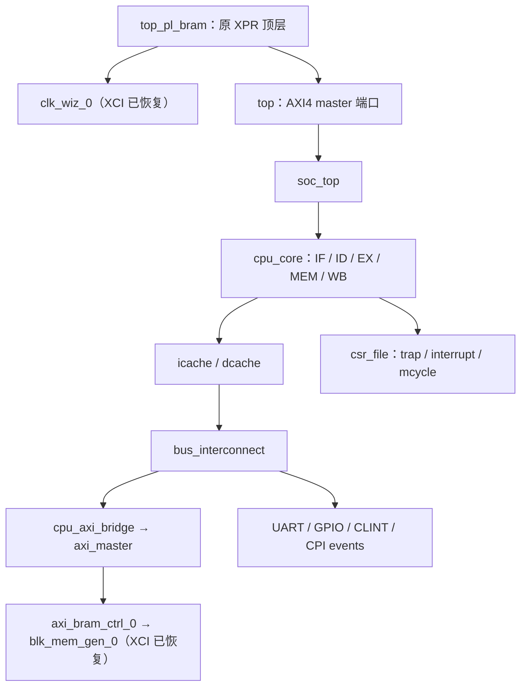
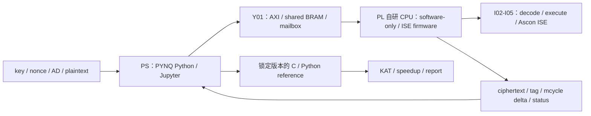

# 系统架构

更新：2026-09-21。下列“当前”来自源码静态检查；“目标”是待实现设计。

## 当前结构

CPU 另含 bypass、stall_ctrl、predictor、multiplier、divider 和流水寄存器。`defines.v` 默认 XLEN=32，RAM_DEPTH=32768；复位 PC 为 `0x10000000`。模块名不必等于文件名，定位见审计。

`top_pl_bram` 约定 50 MHz 输入 XDC、名为 `clk_100m` 的内部时钟及 100 MHz UART 参数；恢复的 clock XCI 确认 PLL 的 50→100 MHz 配置，BRAM XCI 为 32×32768 words（128 KiB），初始化为 freertos_demo.coe。配置不是实测 Fmax。独立原始 XC7Z020 baseline 与保留的 Kintex 工程并存；无 PS block design 或 PYNQ overlay。

## 目标结构与分工

- **CPU/RTL**：保持原 ISA 行为；新增 ISE 的读写寄存器、latency、旁路、stall/flush 和异常契约由 I02 定案。
- **软件**：相同 AEAD API 两种实现；先通过可信 KAT 再 benchmark；不改 GCC backend。
- **PS/PL**：已有 CPU AXI master 不等于 PS 控制接口已经存在。Y01 定地址、buffer 所有权、命令状态机、加载和复位机制。
- **测量**：RISC-V mcycle 测算法，PS 端计时测端到端；二者分列，不混成同一个加速比。
- **PPA**：同 part、约束、tool/IP 版本、实现策略对比，记录时序失败和资源代价。

图是 D01 架构初稿，实物板与 Y01/I02 冻结后更新为报告用定稿。

## 上下游交接

| 上游 | 交付 | 下游 / 门槛 |
|---|---|---|
| B02/B03/B04 | 可重建板级 baseline、固件加载、内存/时钟/计数器证据 | C04、I05、Y01 |
| C01/C03 | 参考版本、KAT hash、结果、AEAD API | I01/I04、V02、Y03/S03 |
| C04/I01 | 可重复周期测量与 hotspot | I02；不能凭猜测选指令 |
| I02/I04 | 编码与语义、单测、latency/异常规范 | I05/I06 |
| I05/I06/V02 | 两套可运行程序与正确性证据 | I07/I08、Y02-Y05 |
| Y01 | 已评审接口版本和板级平台约定 | Y02/Y03、S01/S02 |
| Y05/I08 | 原始测量、资源/时序摘要、环境元数据 | D02-D05、S04/S05 |

全部 owner 留 TBD；接口当前值与待定项集中在 [interfaces](interfaces.md)。
